# 局域网连接打印机常见报错

## 打印机凭证报错

连接打印机的时候出现这种报错

是打印机安全出现了问题

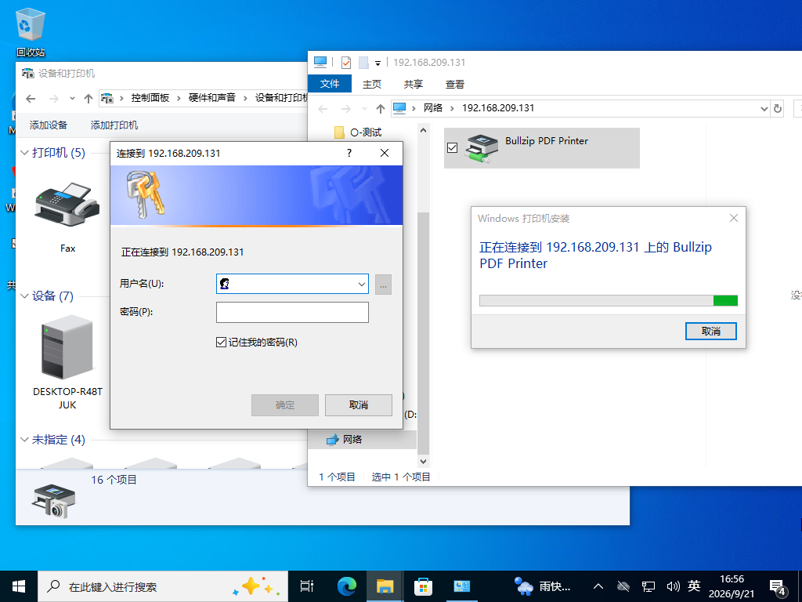

只留着

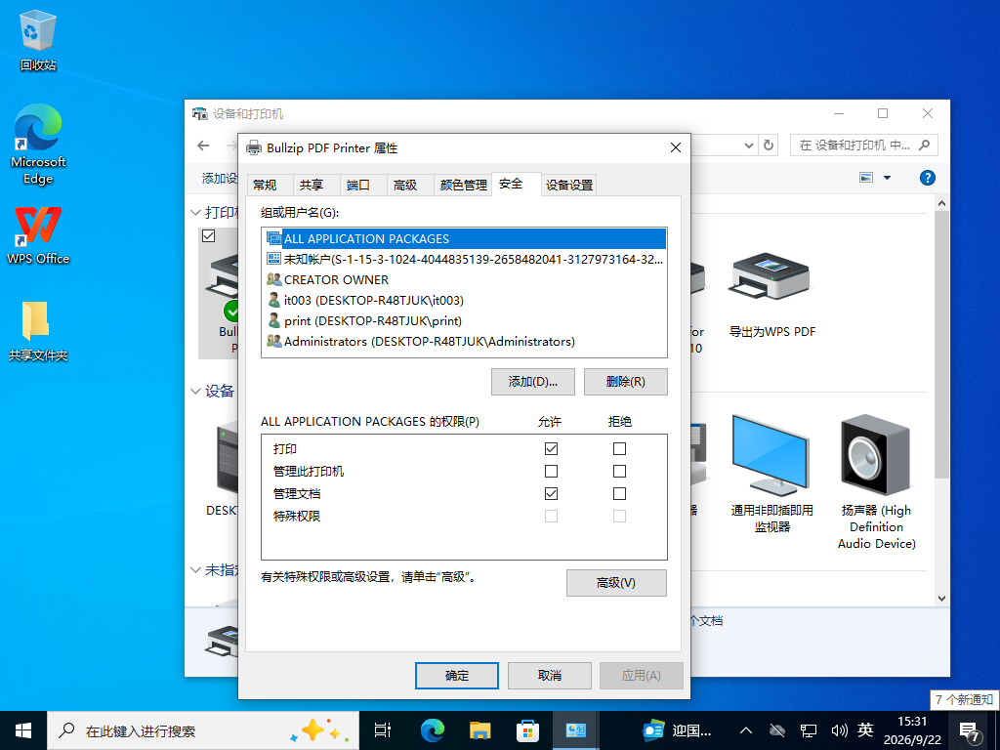

> 解决方案一

凭据设置错误，在使用print账号的时候在安全中删除这个print

就会导致连接打印机的时候出现凭据错误

打印机安全中最好如此设置

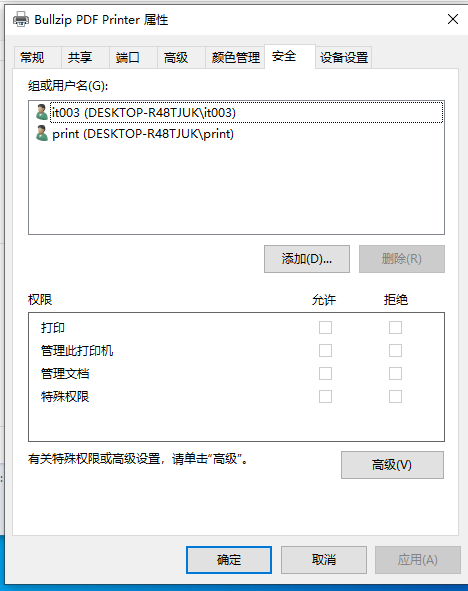

> 解决方案二

如果使用了everyone用户和当前用户，当前用户没有设置密码的话会出现如下情况

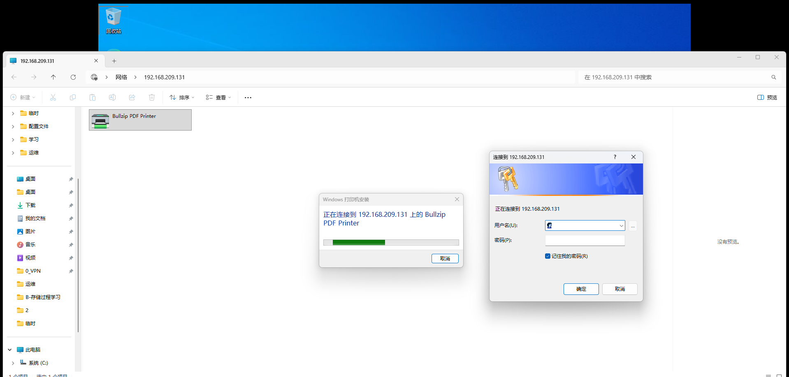

这个时候即使输入的是安全中的用户还是无法连接

添加回print正常凭证即可

确保网络与共享中心为：

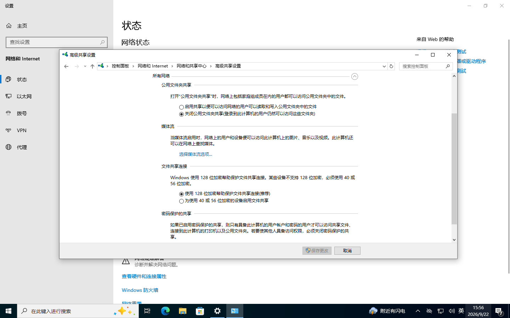

## [打印机报错 0x0000011b](https://zhuanlan.zhihu.com/p/670886491)

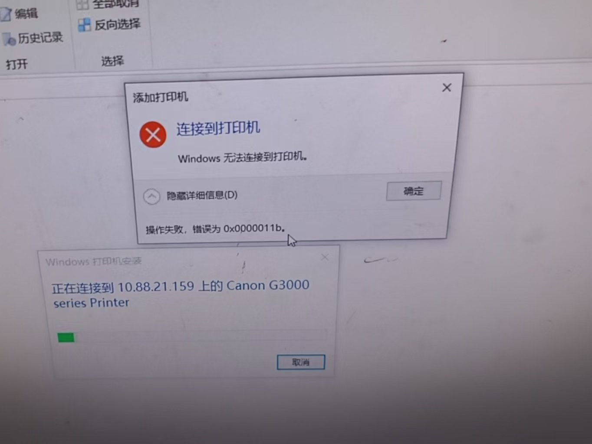

## 打印机报错 0x00000005

## [打印机报错  0x0000052e](https://www.baiyunxitong.com/bangzhu/6397.html)

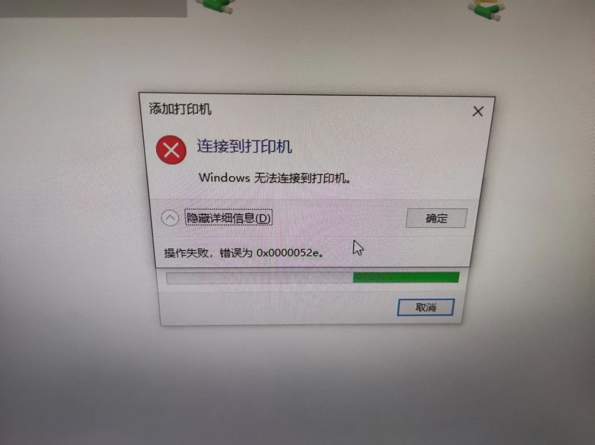

## [打印机报错总体表格(未实验)](https://www.cnblogs.com/suv789/p/18949083)

表格一

| **错误代码或问题**                         | **可能原因**                                           | **解决方案**                                                 |
| ------------------------------------------ | ------------------------------------------------------ | ------------------------------------------------------------ |
| **"Printer is not responding"**            | 打印机未正确连接、打印机服务停止或网络问题             | 1. 检查打印机的物理连接（USB、Wi-Fi）。 2. 确保打印机处于“在线”状态。 3. 重启打印机和计算机。 |
| **0x0000011b**                             | 打印机驱动程序冲突，尤其是在Windows 10与网络打印机之间 | 1. 更新Windows系统和打印机驱动程序。 2. 禁用Windows 10的“计算机共享打印”设置。 3. 运行Windows故障排除工具。 |
| **"Document failed to print"**             | 打印文件格式不支持、文件损坏或权限问题                 | 1. 确保打印文档的格式被支持。 2. 检查文件是否损坏。 3. 确保具有打印文件的访问权限。 |
| **0x000003e3**                             | 打印机与计算机之间的网络连接断开或配置错误             | 1. 确保打印机与计算机连接的网络是相同的。 2. 重新配置打印机的网络设置。 |
| **"Error printing"**                       | 打印队列卡住或文件格式不兼容                           | 1. 清空打印队列。 2. 重启打印服务。 3. 检查文件格式是否与打印机兼容。 |
| **0x00000057**                             | 打印机驱动程序缺失或无法加载                           | 1. 更新或重新安装打印机驱动程序。 2. 检查驱动程序是否已正确安装并与操作系统兼容。 |
| **"Printer not found"**                    | 打印机连接断开或驱动程序未安装                         | 1. 确保打印机正确连接到计算机。 2. 检查并重新安装打印机驱动程序。 |
| **0x000003e5**                             | 打印机无响应，打印任务无法启动                         | 1. 重启打印机。 2. 清空打印队列。 3. 检查打印服务是否已启动。 |
| **"Print spooler service is not running"** | 打印服务未启动或损坏                                   | 1. 进入“服务”管理工具，启动“Print Spooler”服务。 2. 重新启动计算机。 |
| **0x000006ba**                             | 打印机配置问题，打印机驱动程序冲突                     | 1. 卸载并重新安装打印机驱动程序。 2. 确保打印机与操作系统兼容。 3. 更新系统和驱动程序。 |
| **"Printer is in use"**                    | 打印机被占用，其他打印任务正在执行                     | 1. 等待当前打印任务完成。 2. 清空打印队列并重新启动打印机。  |
| **0x000000c1**                             | 打印任务设置问题，文件格式或驱动程序问题               | 1. 检查打印任务设置。 2. 确保文件格式正确并与打印机兼容。 3. 更新驱动程序。 |
| **"The printer is out of paper"**          | 打印机缺纸或进纸器卡纸                                 | 1. 检查并补充纸张。 2. 清理打印机进纸器，确保没有卡纸。      |
| **"Low ink or toner"**                     | 打印机墨水或碳粉不足                                   | 1. 更换墨盒或碳粉。 2. 检查打印机的墨水或碳粉状况，及时更换。 |
| **"Paper Jam"**                            | 打印机卡纸                                             | 1. 打开打印机并取出卡住的纸张。 2. 检查打印机内部是否有纸屑或杂物。 |
| **0x00000709**                             | 打印机设置问题，默认打印机设置错误                     | 1. 在“设备和打印机”中设置正确的默认打印机。 2. 检查打印机共享和连接设置。 |

表格二

| **错误代码或问题**                                  | **可能原因**                                     | **解决方案**                                                 |
| --------------------------------------------------- | ------------------------------------------------ | ------------------------------------------------------------ |
| **0x0000001f**                                      | 打印队列文件损坏，导致打印任务无法启动           | 1. 清空打印队列。 2. 检查打印文件格式并重新提交打印任务。    |
| **"Print job stuck in queue"**                      | 打印队列卡住，无法继续执行打印任务               | 1. 清空打印队列。 2. 重启打印机和计算机。 3. 禁用并启用打印机队列服务。 |
| **0x00000103**                                      | 打印机和计算机之间的USB连接不稳定或断开          | 1. 检查并重新连接USB线。 2. 尝试更换USB端口。                |
| **"Printer offline"**                               | 打印机处于离线状态，无法进行打印                 | 1. 检查打印机电源是否开启。 2. 确保打印机连接到正确的网络或计算机。 3. 设置打印机为“在线”。 |
| **0x00000063**                                      | 打印机驱动程序未正确安装或文件损坏               | 1. 卸载并重新安装最新的打印机驱动程序。 2. 更新操作系统和打印机驱动程序。 |
| **"The printer is not responding to the computer"** | 打印机没有响应，连接断开或驱动问题               | 1. 检查打印机电缆和网络连接。 2. 确保驱动程序已正确安装。 3. 重启打印机和计算机。 |
| **"Printer out of memory"**                         | 打印任务过大，打印机内存不足                     | 1. 减少打印任务的复杂性或大小。 2. 增加打印机的内存（如果支持）。 |
| **"Failed to connect to printer"**                  | 打印机未能连接到网络或计算机                     | 1. 确保打印机连接到正确的网络。 2. 检查打印机与计算机之间的连接设置。 |
| **"Printer unable to start job"**                   | 打印机启动任务失败，可能是驱动或服务问题         | 1. 重启打印机和计算机。 2. 更新或重新安装打印机驱动程序。 3. 检查打印服务是否启动。 |
| **"Spooler error"**                                 | 打印机队列服务出现错误或卡住                     | 1. 重启“Print Spooler”服务。 2. 清空打印队列。 3. 重新启动计算机。 |
| **"The printer driver is unavailable"**             | 打印机驱动程序丢失或不兼容                       | 1. 重新安装适用于打印机的驱动程序。 2. 检查驱动程序版本与操作系统兼容性。 |
| **0x0000011d**                                      | 打印机无法识别，可能是USB连接或驱动问题          | 1. 检查并确认打印机连接正常。 2. 更新打印机驱动程序。 3. 尝试使用不同的USB端口。 |
| **"Unable to install printer"**                     | 安装打印机时出现问题，可能是权限不足或网络错误   | 1. 确保具有管理员权限。 2. 检查网络连接或打印机共享设置。 3. 重新安装打印机驱动。 |
| **"Print driver is blocked"**                       | 打印机驱动程序被操作系统或安全软件阻止           | 1. 检查防火墙或杀毒软件设置，确保没有阻止打印机驱动程序。 2. 允许打印机驱动程序通过安全软件的检测。 |
| **0x000006b9**                                      | 打印机访问权限问题，可能是用户权限或共享设置错误 | 1. 检查打印机共享设置，确保用户具有访问权限。 2. 重新配置打印机访问权限。 |
| **"Printer error"**                                 | 打印机无法正常工作，可能是硬件问题或驱动程序损坏 | 1. 检查打印机硬件是否正常。 2. 更新或重新安装打印机驱动程序。 3. 进行打印机自检。 |
| **0x000003c4**                                      | 打印机驱动不兼容或系统更新后发生错误             | 1. 确保打印机驱动程序与当前操作系统兼容。 2. 卸载并安装适合版本的驱动程序。 |

表格三

| **错误代码或问题**              | **可能原因**                                           | **解决方案**                                                 |
| ------------------------------- | ------------------------------------------------------ | ------------------------------------------------------------ |
| **"Print job stuck"**           | 打印任务卡住，未能成功提交到打印队列                   | 1. 清空打印队列并重新启动打印机。 2. 删除卡住的打印任务，重新尝试。 |
| **"Paper Jam"**                 | 打印机纸张卡住，可能是纸张质量问题或打印机进纸机制故障 | 1. 打开打印机并移除卡住的纸张。 2. 检查打印机的进纸通道是否有其他异物。 3. 使用适合的纸张进行打印。 |
| **"Low ink"**                   | 打印机墨水或碳粉不足，无法完成打印                     | 1. 更换墨盒或碳粉盒。 2. 检查墨水水平，并根据需要更换。      |
| **"Printer is busy"**           | 打印机正在处理其他任务，无法响应当前打印请求           | 1. 等待打印机完成当前任务。 2. 清空打印队列并重新尝试。      |
| **"Incorrect paper size"**      | 打印纸张大小设置不匹配，打印机无法识别纸张尺寸         | 1. 检查打印机设置的纸张尺寸是否与实际纸张一致。 2. 确认打印任务的纸张大小设置。 |
| **"Invalid Printer State"**     | 打印机处于无效状态，无法执行打印任务                   | 1. 重启打印机。 2. 检查打印机连接和电源。 3. 更新或重新安装打印机驱动程序。 |
| **"Out of toner"**              | 激光打印机碳粉耗尽，无法继续打印                       | 1. 更换碳粉盒。 2. 检查是否正确安装了新的碳粉盒。            |
| **"Printer not found"**         | 找不到打印机，可能是网络问题或驱动程序问题             | 1. 检查打印机是否正确连接到网络。 2. 确保驱动程序已正确安装并与打印机兼容。 |
| **"Warming up"**                | 打印机正在预热中，无法立即打印                         | 1. 等待打印机完成预热。 2. 确保打印机处于正常工作温度下。    |
| **"Out of paper"**              | 打印机没有纸张或纸张未正确放置                         | 1. 确保纸盘中有足够的纸张。 2. 检查纸张是否放置正确。        |
| **"Connection lost"**           | 打印机与计算机之间的连接中断                           | 1. 检查打印机和计算机之间的连接。 2. 如果使用无线打印，确保Wi-Fi信号稳定。 |
| **"Print job canceled"**        | 打印任务被取消，可能是用户操作或系统错误               | 1. 重新提交打印任务。 2. 检查打印队列，确保没有其他任务被取消。 |
| **"Printer not responding"**    | 打印机未响应，可能是由于驱动程序问题或设备故障         | 1. 检查打印机电源。 2. 重启打印机和计算机。 3. 重新安装或更新打印机驱动程序。 |
| **"Firmware error"**            | 打印机固件出现问题，导致打印任务无法完成               | 1. 检查打印机是否需要更新固件。 2. 下载并安装最新的固件版本。 |
| **"Error code 52"**             | 打印机驱动程序签名不正确，可能是操作系统的安全设置限制 | 1. 禁用驱动程序签名强制检查。 2. 更新或重新安装受信任的打印机驱动程序。 |
| **"Ink cartridge error"**       | 墨盒安装不当或损坏，导致打印机无法正常工作             | 1. 检查墨盒是否正确安装。 2. 更换损坏的墨盒。                |
| **"Printer overheating"**       | 打印机过热，导致无法继续打印任务                       | 1. 关闭打印机，让其冷却。 2. 确保打印机放置在通风良好的地方。 |
| **"Print spooler not working"** | 打印机队列管理服务失败，导致无法提交打印任务           | 1. 重启“Print Spooler”服务。 2. 清空打印队列。 3. 检查系统是否有权限问题。 |

表格四

| **错误代码或问题**          | **可能原因**                                                 | **解决方案**                                                 |
| --------------------------- | ------------------------------------------------------------ | ------------------------------------------------------------ |
| **"Printer offline"**       | 打印机被设置为离线模式或无法连接到计算机                     | 1. 确保打印机处于在线状态。 2. 检查打印机与计算机的连接。 3. 重新启动打印机和计算机。 |
| **"Toner not detected"**    | 打印机无法识别安装的碳粉盒，可能是碳粉盒损坏或安装不当       | 1. 确认碳粉盒正确安装。 2. 更换新的碳粉盒。 3. 检查打印机接口是否有污垢或损坏。 |
| **"Color mismatch"**        | 打印的颜色与预期不一致，可能是打印机设置或墨水问题           | 1. 检查打印机的色彩设置。 2. 校准打印机的颜色。 3. 更换墨盒或清洁喷头。 |
| **"Invalid paper type"**    | 打印机识别到的纸张类型与实际使用的纸张类型不符               | 1. 确保选择了正确的纸张类型。 2. 检查纸张是否符合打印机支持的规格。 3. 更换纸张类型。 |
| **"Unable to connect"**     | 无法连接到网络打印机或共享打印机，可能是网络配置错误         | 1. 确保网络连接正常。 2. 检查打印机的IP地址是否正确。 3. 重新配置打印机网络设置。 |
| **"Printer queue full"**    | 打印队列已满，无法继续处理新的打印任务                       | 1. 清空打印队列并删除失败的任务。 2. 重新启动打印机。 3. 确保计算机上没有其他打印任务。 |
| **"Print cartridge error"** | 打印机无法识别安装的打印碳粉或墨盒                           | 1. 检查墨盒是否正确安装并清洁接触点。 2. 更换碳粉盒或墨盒。 3. 确认墨盒是否为原装部件。 |
| **"No paper in tray"**      | 纸盘中没有纸张或纸张放置不当                                 | 1. 确保纸盘中有足够的纸张，并且纸张放置正确。 2. 检查纸盘是否有卡纸。 |
| **"Maintenance request"**   | 需要进行维护，可能是定期维护提示或打印机检测到需要清洁或更换部件 | 1. 执行打印机维护操作（例如清洁、检查或更换部件）。 2. 查阅打印机手册，执行推荐的维护步骤。 |
| **"Error code 0x000003eb"** | 打印机驱动程序或USB连接错误，通常发生在Windows操作系统中     | 1. 卸载并重新安装打印机驱动程序。 2. 尝试更换USB端口或使用不同的连接方式。 |
| **"Cartridge missing"**     | 打印机无法检测到打印墨盒，可能是墨盒未正确安装或连接不良     | 1. 检查墨盒是否安装正确并且与打印机接触良好。 2. 更换损坏或过期的墨盒。 |
| **"Device not ready"**      | 打印机未准备好，可能是由于打印机尚未启动或正在进行内部处理   | 1. 等待打印机完成初始化过程。 2. 确保打印机没有处于睡眠模式或待机状态。 |
| **"Error code 79"**         | 打印机硬件故障，通常发生在打印机处理过程中或由驱动程序错误引起 | 1. 重新启动打印机。 2. 更新或重新安装打印机驱动程序。 3. 如果问题依然存在，联系制造商技术支持。 |
| **"No connection"**         | 打印机与计算机或网络设备之间失去连接                         | 1. 检查打印机与计算机或网络设备的连接是否正常。 2. 尝试重新启动打印机和计算机。 |
| **"Insufficient memory"**   | 打印机内存不足，无法处理大文件或复杂的打印任务               | 1. 将打印任务分解成较小的部分。 2. 调整打印质量设置，减小文件大小。 3. 清理打印机缓存。 |
| **"Printer not supported"** | 打印机与计算机或操作系统不兼容                               | 1. 更新打印机驱动程序。 2. 确认打印机支持的操作系统版本。 3. 如果不支持，考虑更换打印机或使用其他驱动程序。 |

# Windows共享打印机常见问题

## 共享打印机

打开控制面板，选中需要共享的打印机

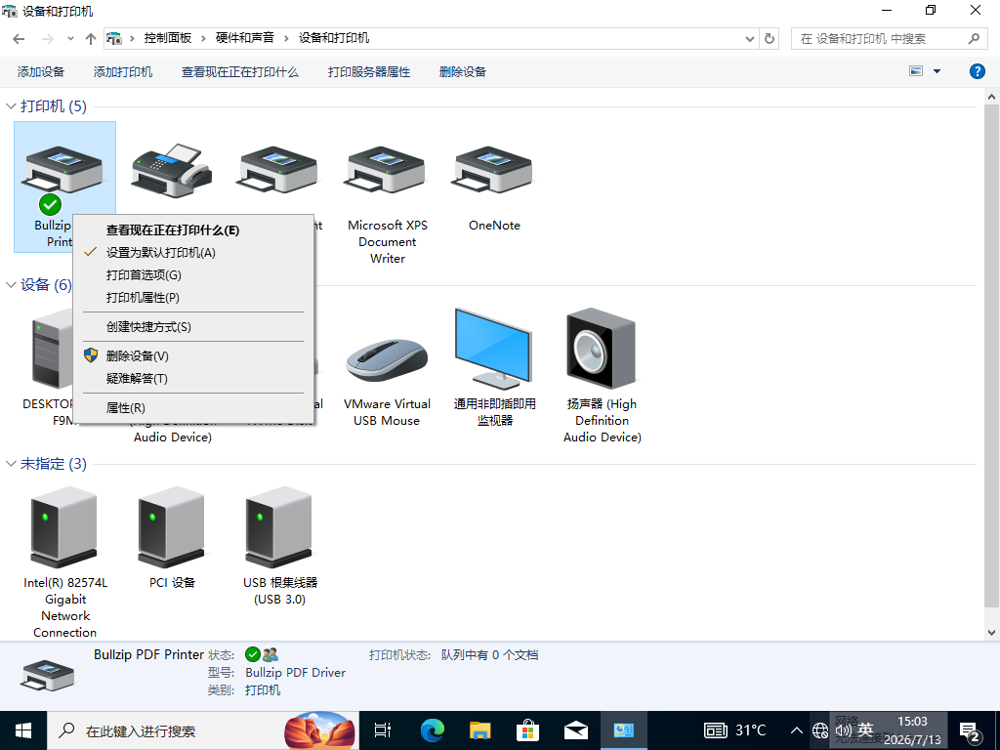

选用打印机属性，点击共享

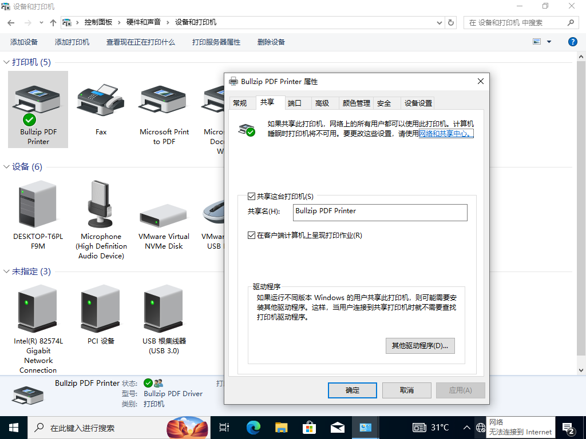

选择安全，设置对应的用户权限

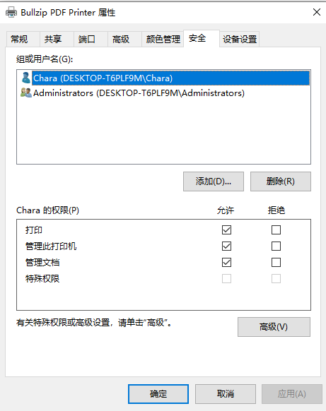

实际上也可以使用当前设备的设备名称，来链接对应的打印机

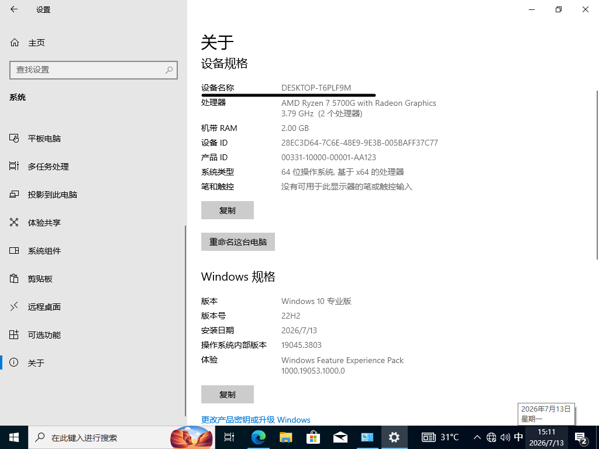

在CMD中填写如下信息，可以连接进打印机

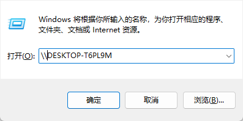

设置 → 蓝牙和其他设备 → 打印机和扫描仪 → "添加设备"

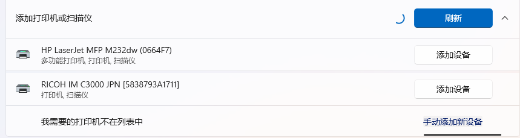

点击手动添加新设备，输入对应的IP地址

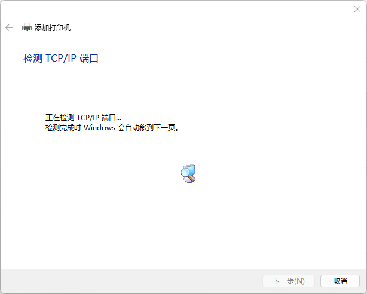

检索的到就有了

## 打印机连接不上

一般来说先检查接口，打印机在电脑端的接口应该接到蓝色的USB口上.因为那里的口是3.0的口

打印机尺寸可以在客户端上设置，记得保存成U9，最后才是检查打印机驱动的问题

打印机连接不上先重新连接

然后，打印机格式需要设置为指定格式

生产部的打印机格式为U9

## [打印机跳页](https://zhuanlan.zhihu.com/p/577456433)

在U9中设定的格式不对，需要在打印机设置中设置对应尺寸大小的格式

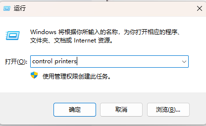

选中打印机

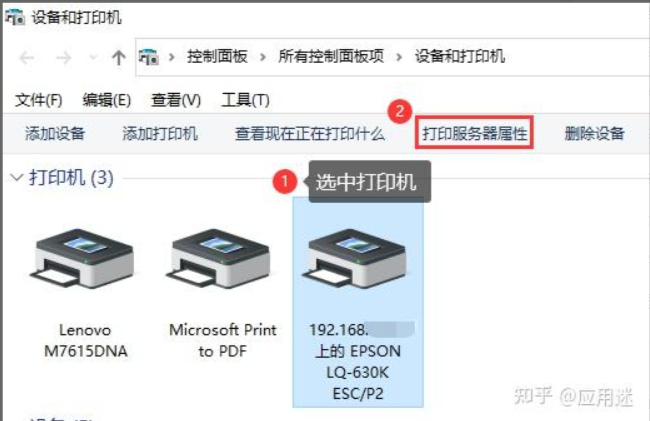

## [打印机系统单据格式](https://weisdcw.com/article/detail/10461.html)

### 打印机长时间反应不过来

可能是杀毒软件拦截了打印机服务

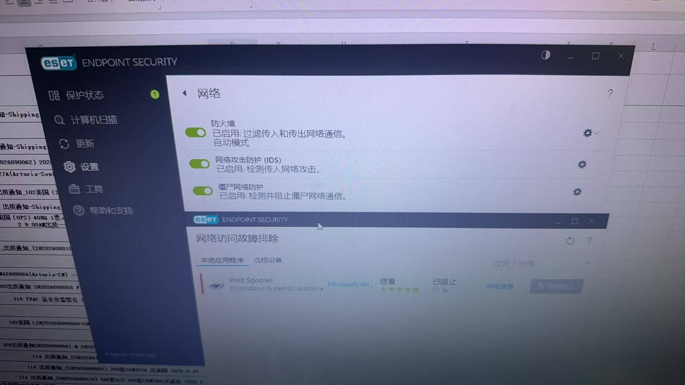

导致打印时间变慢

### 打印机账号被锁

打印机账号输入太多次错误密码导致被锁

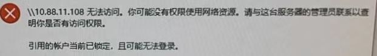

这个锁定发生在 服务器上，管理员可以：

- 在服务器上打开「本地用户和组」，把被锁定账号的【账户已锁定】勾选取消；

- 如果是域环境，在域控服务器解锁该用户账号。

命令是：lusrmgr.msc

## 打印机硬件耗材

### 换色带

色带是打印机的打印耗材，有两种盒子。一种是小盒子一种是大盒子。

这种叫做针式打印机。

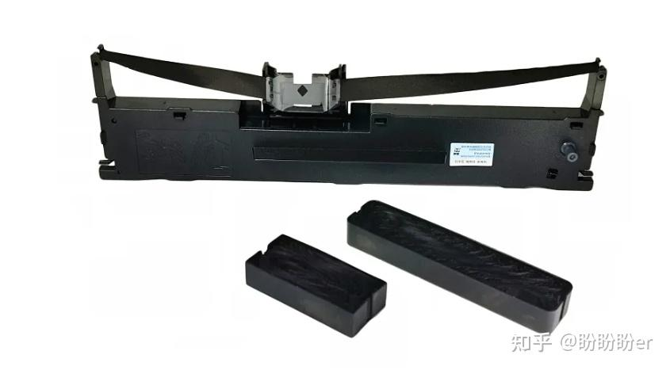

更换步骤：

> 步骤一：打开盖子，取出塑料支架

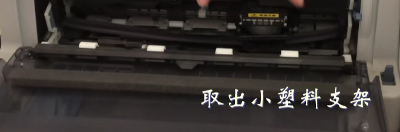

> 步骤二：取出色带架

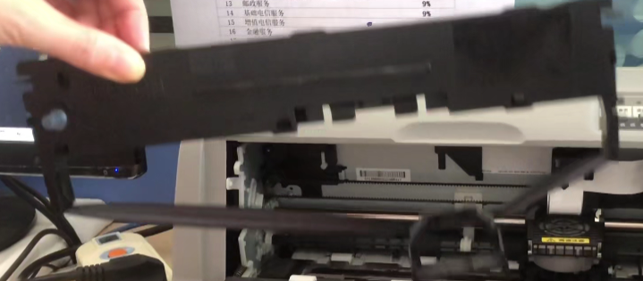

> 步骤三：如果有挡片，拆出来

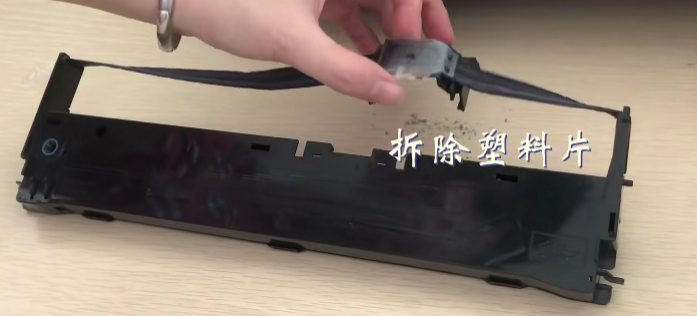

> 步骤四：把色带拉出来

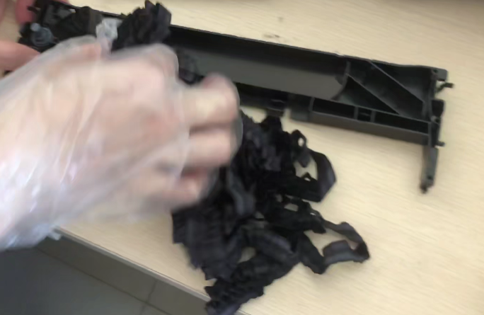

> 步骤五：装上新色带

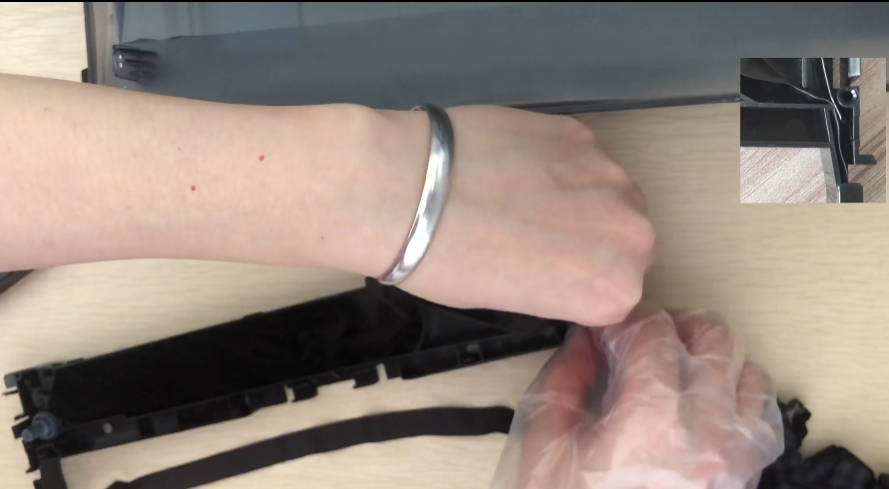

需要注意的是内部过度的地方必须要有一个折点，要不然两边都无法顺利利用

> 步骤六：装回卡扣

  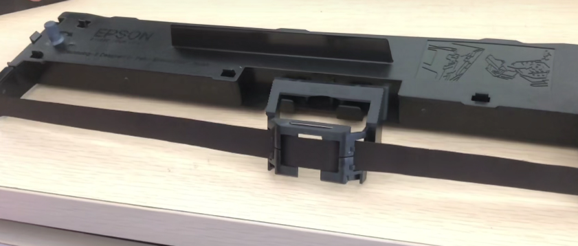

这样就行了

### 热转印换色带

首先装纸袋

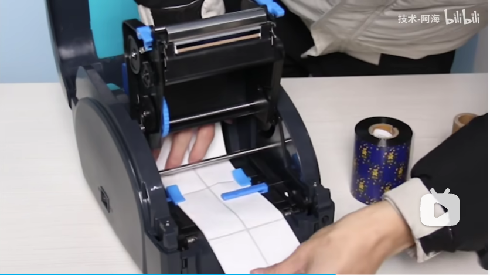

这个卡纸的需要再纸张中间

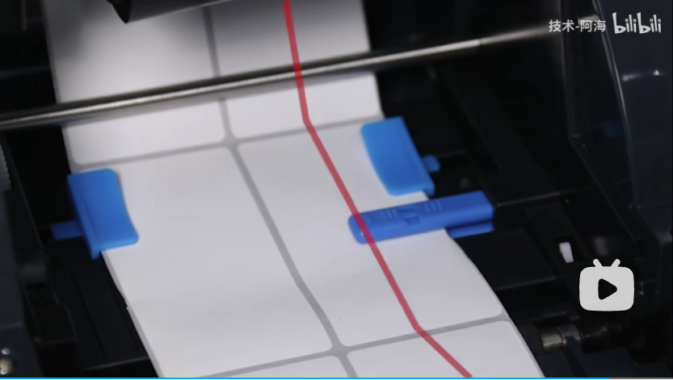

大的卷纸装在下面胶带部分向上

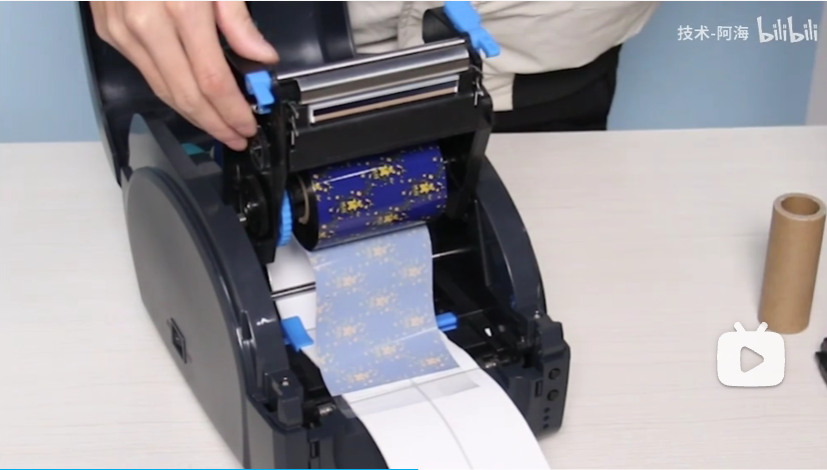

然后使用胶带放到空卷上

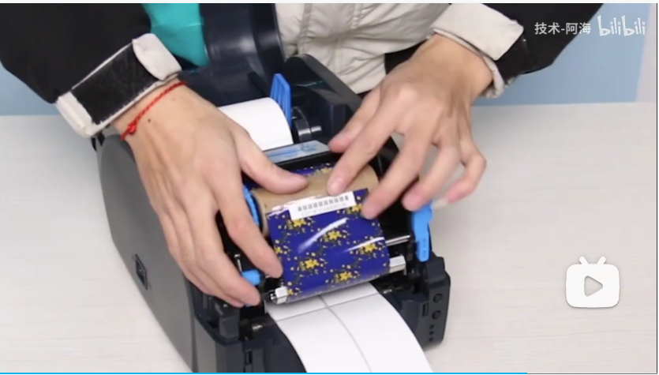

拉到黑色即可

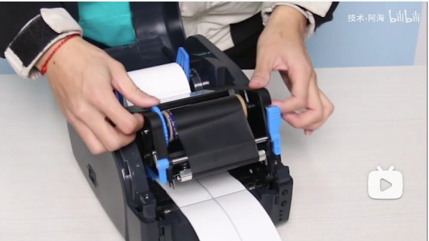

### 色带出现褶皱

取下中间的弹簧

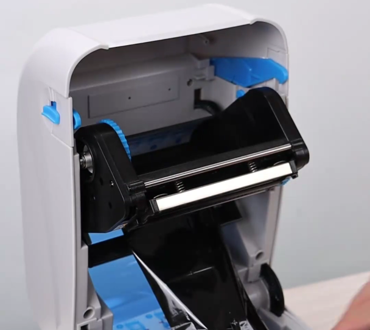

测试纸方法

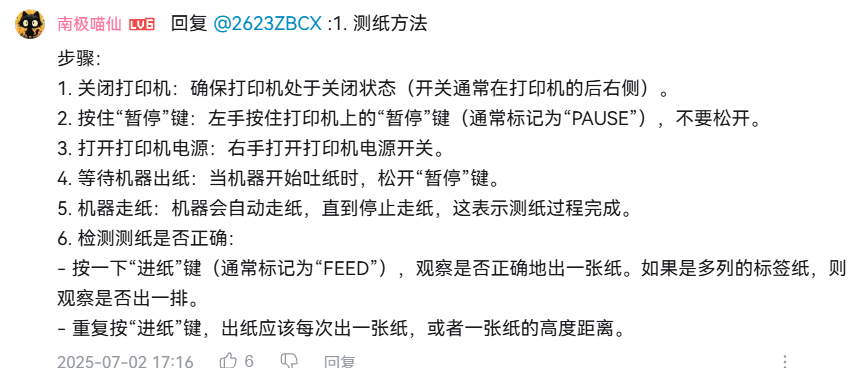

### 碳带出现破损

一般是浓度调整太高了

### 打印机出现异响

一般是齿轮没有润滑

或者履带没有润滑

### 惠普打印机报错

重启惠普打印机，这是有线打印机报错。

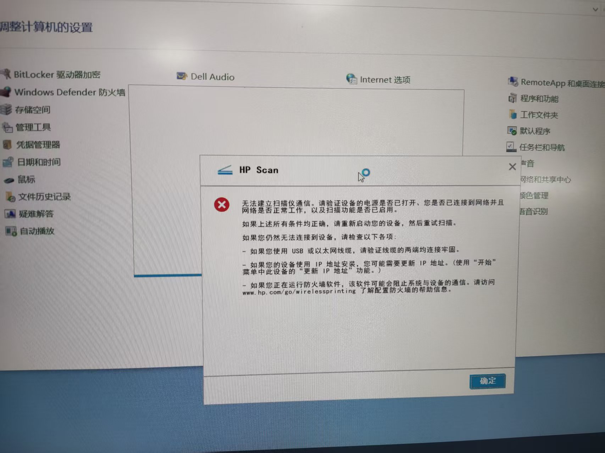

### 打印机清零G3000

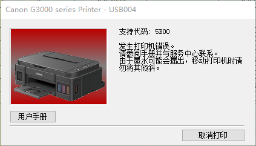

出现这种错误就是要清零了

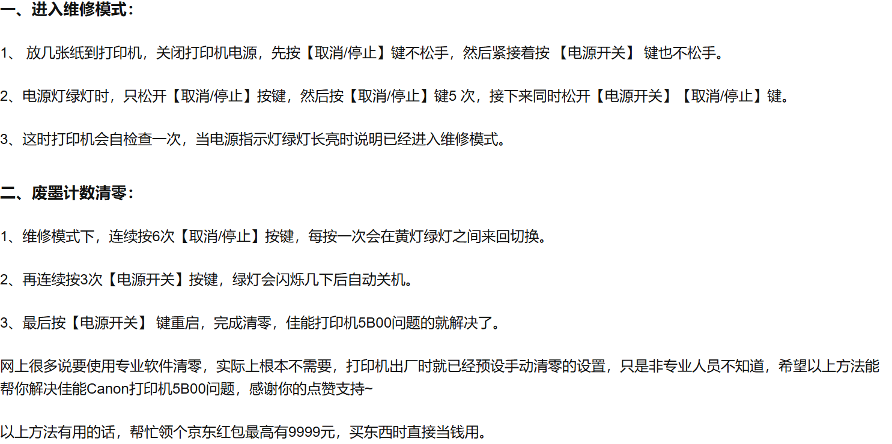

### 删除打印机驱动

`printui /s /t2` 并回车