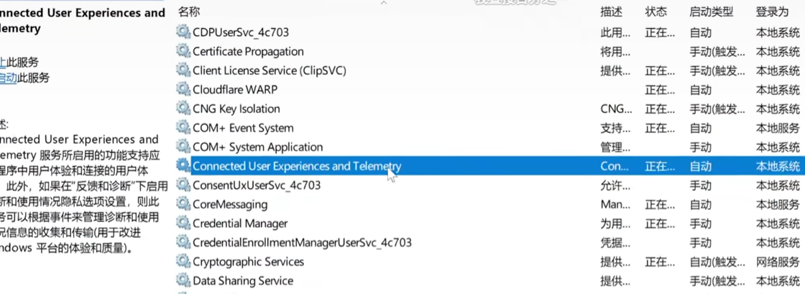

## 使用DG查看硬盘

有可能会出现转速损坏的情况


## 关闭服务遥测

关闭这个`Connected Used Experiences and Telemetry` 这个是windows检测本地数据的会造成数据的读取频繁



## 修复windows系统镜像

右键开始菜单 → Windows终端(管理员)

输入：

```shell
· sfc /scannow
· DISM /Online /Cleanup-Image /RestoreHealth
```

