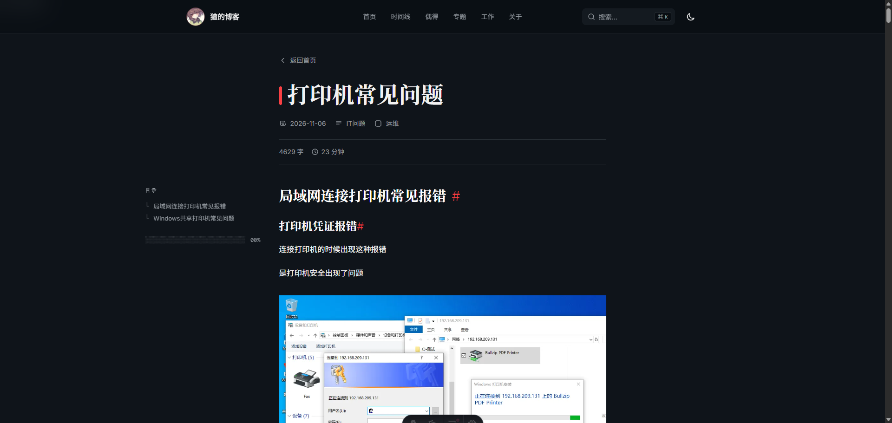

> 本文简述了技术文档写作规范，目的是为了减少沟通成本。也希望我能常常注意写作规范。

## 1. 标题规范

一般而言，一篇文章不推荐使用一级标题。因为大部分博客框架会自动将 frontmatter（表头）中的 title 元素渲染到顶部，使用一级标题会造成观感上的重复。

如下例子： :no_entry:

推荐全文使用  `##`  （二级标题），原则上只使用二级标题和三级标题。标题分级越多，会影响目录的结构。假如还需要多一级标题，那么使用列表目录作为代替。

使用列表模拟目录标题为例：

推荐使用 :white_check_mark: 

- 文章标题 (二级标题) ：1
  - 文章小标题 (三级标题)
- 文章标题：2
  - 文章小标题

不推荐使用 :no_entry:

- 文章主旨(一级标题)
  - 文章标题：1 (二级标题)
  - 文章标题：2
  - 文章标题：3
- 另开一行大标题
  - 文章标题：1

### 标题命名规范

原则上说，一个标题需要能够总结段落的核心内容。其影响 SEO 的检索结果。

例如，我编写如何解决戴尔的打印机报错问题，那么这个标题就可以是"戴尔打印机报错解决方案"，其下介绍遇到这个报错的背景问题。相对应的，其子标题就需要补充戴尔打印机的各种报错码类型。这是最基础的标题命名规则。

从上文可以得出，标题的渐进关系应该是：宽泛包含具体。在母标题中可以介绍此问题的历史背景等宽泛信息，在子标题中聚焦于具体解决方法。

标题设计可以遵循SPA原则：

- 简明扼要（Simple） 标题不宜过长（建议控制在10个中文字以内），只保留核心关键字。

- 利益相关（Profit） 利益指的是标题要体现目标读者所关注的内容，即读者切实感兴趣的点。

- 准确客观（Accurate） 不宜过多表达主观情绪，在字数有限的情况下概括出全文核心本质，而概括全文便是运用了结构化思维中的“以上统下”。
  
